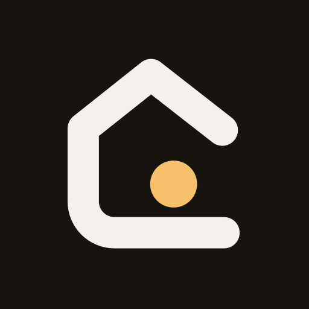
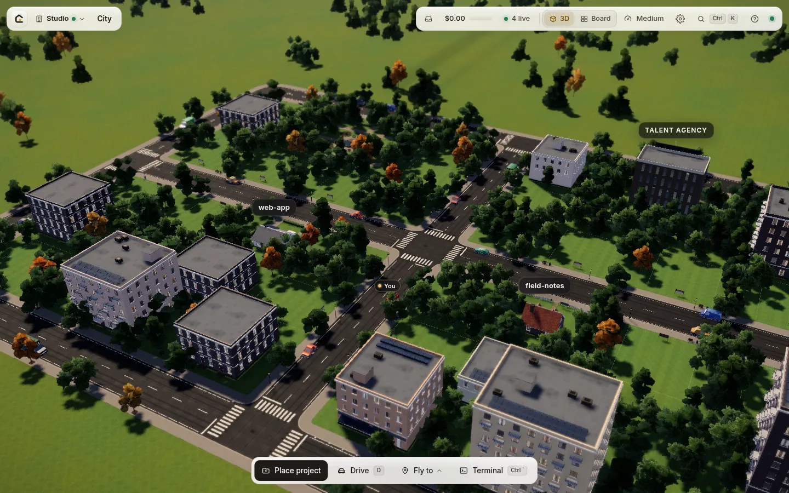

<p align="center">
  
</p>

<h1 align="center">CAST</h1>

<p align="center">
  <strong>A little 3D town where your AI coding agents live and work.</strong><br>
  Every project is a house, every agent is a person living in it, and what a person does in the town is what the
  agent is doing on your files.
</p>

<p align="center">
  <a href="https://github.com/JirapatWov/cast-town/actions/workflows/ci.yml"></a>
  <a href="https://github.com/JirapatWov/cast-town/releases/latest"></a>
  <a href="LICENSE"></a>
</p>

<p align="center">
  <a href="https://casttown.dev">Website</a> ·
  <a href="https://casttown.dev/docs/">Documentation</a> ·
  <a href="https://github.com/JirapatWov/cast-town/releases/latest">Download</a> ·
  <a href="https://github.com/JirapatWov/cast-town/issues">Issues</a>
</p>



## Highlights

- **Every model, one town.** Claude, GPT, Gemini, DeepSeek, OpenRouter and the other providers the agent knows, plus
  model servers on your own network (llama.cpp, Ollama, LM Studio). Each person has their own model, teams can mix
  vendors, and CAST never swaps a model behind your back.
- **Teams that pass the work along.** Describe a task once: the lead proposes a team, you approve the plan, and the
  work moves from person to person. Reviewers send it back when it isn't right.
- **You stay in control.** A permission mode per house (Ask first, Accept edits, Auto, Bypass), approvals that show
  the command or the diff, and a checkpoint before every team run so you can put the folder back.
- **See what changed.** Each house has a TV with its git diff, and every job has its own Changes and Inbox.
- **3D or not.** The town in 3D, or the Board: a fast 2D list that works with a keyboard and a screen reader. A command
  palette reaches everything.
- **On every device.** A menu-bar app for the Mac, a one-file server for Linux, and an installable web app with
  notifications on phones.
- **Yours.** It runs on your machine; your code, sign-ins and chats stay there. MIT-licensed, with its own agent
  (cast-agent, in `agent/`, based on [oh-my-pi](https://github.com/can1357/oh-my-pi)).

## Quick start

| Your machine | Get CAST |
|---|---|
| **macOS** on Apple Silicon, macOS 13 or newer | Download `CAST-<version>-arm64.dmg` from [Releases](https://github.com/JirapatWov/cast-town/releases/latest), drag CAST onto Applications and open it. The app is notarized by Apple ([Mac app](#mac-app)). |
| **Linux** x64 | Download `cast-<version>-linux-x64.tar.gz` from [Releases](https://github.com/JirapatWov/cast-town/releases/latest), unpack it and run `./cast-server` in its folder. No Bun needed. |
| **From source** on Linux, macOS or WSL 2 | `git clone`, `bun install`, `bun run build`, `bun run start` ([Install](#install)). |

Then pair your browser (the Mac app does it for you; the server prints the command), connect an AI account, and place
your first project on a lot. The full guide is at [casttown.dev/docs](https://casttown.dev/docs/).

> **CAST runs agents and a shell with your user's rights.** Whoever can open your CAST can do anything your account
> can do on that machine. It listens on `127.0.0.1` only, and every browser has to be paired with a secret link.
> Read [SECURITY.md](SECURITY.md) before you make it reachable from other devices.

**Status:** CAST is young (0.1). It is developed on Linux; macOS is supported through the menu-bar app and from
source. Windows is supported only through WSL 2. The interface is in English.

## How the town works

| Real thing | In the town |
|---|---|
| Your workspace | The town |
| A project folder | A house on a lot (pick an existing folder, or create a project from a template) |
| A job: a separate line of work in that folder, with its own people and chats | A room in the house. Add floors for more rooms, and the building grows taller |
| An agent (one cast-agent process per role) | A person in the house, wearing their vendor's colour (Claude terracotta, GPT mint, DeepSeek blue, Gemini violet) |
| A prompt | Click a person and chat. They walk to a station and get to work |
| Tool use | Reading: the bookshelf. Editing: typing at a desk. Shell commands: the kitchen counter. Web: phone on the sofa. Waiting for you: a raised hand |
| An agent's sub-agent (task tool) | A helper walks in the front door, does chores while working, and leaves when done |
| A team (workflow): roles you or the lead put together | The corkboard. Roles hand a folder to each other, on different models if you like |
| `git diff` | The living-room TV (click it for the full diff viewer) |
| Models and AI accounts | The Talent Agency building |

Everything in 3D can also be done from the 2D panels and the command palette (`Ctrl+K`, `⌘K` on a Mac). The **Board**
(the Town view switch in the top bar, or `` ` ``) lists every house instead of the 3D town: quicker on slow computers
and easiest with a keyboard or screen reader. CAST remembers the choice, and a Board start never loads the 3D town.

## Contents

- [Install](#install)
- [Mac app](#mac-app)
- [Connect an AI account](#connect-an-ai-account)
- [Using CAST](#using-cast)
- [More than one machine (cities)](#more-than-one-machine-cities)
- [Phones and other devices](#phones-and-other-devices)
- [Chat apps through Hermes Agent](#chat-apps-through-hermes-agent)
- [Install CAST on your phone](#install-cast-on-your-phone)
- [Configuration](#configuration)
- [Where CAST keeps things](#where-cast-keeps-things)
- [Updating and uninstalling](#updating-and-uninstalling)
- [Troubleshooting](#troubleshooting)
- [Known limits](#known-limits)
- [Contributing, security and credits](#contributing-security-and-credits)

## Install

The [Mac app](#mac-app) and the Linux build on the
[Releases page](https://github.com/JirapatWov/cast-town/releases/latest) need nothing else installed: unpack the
Linux build, run `./cast-server` in its folder, and it prints the command that shows your pairing link. The rest of
this section installs CAST from source.

You need:

- **Linux or macOS** (on Windows, use WSL 2), as a normal user. Don't run CAST as root.
- **[Bun](https://bun.sh) 1.3.14 or newer**: `curl -fsSL https://bun.sh/install | bash`
- **git**
- **The agent (cast-agent)** comes with CAST in `agent/`: no separate install. `bun run build` builds it, with network
  access to registry.npmjs.org (it downloads a prebuilt native addon).
- **Disk:** the clone is about 210 MB; after `bun run build` the CAST folder takes about 2.5 GB, plus about 1.7 GB of
  Bun's download cache in your home folder.
- **Memory:** each person who is working runs their own agent process, using about 200–360 MB of RAM. Pressing
  Refresh under Models & providers reuses a recent check instead of starting another agent.
- **A browser with WebGL 2**: a recent Chrome, Edge, Firefox or Safari. A computer downloads about 12 MB before the 3D
  town appears (the full-size sky and the parked car follow once it is on show); the top bar, chat and Town board work
  within seconds while it loads, and a house's furniture and people load when you first open it. Phones start on the
  Town board, which needs well under 1 MB, until you switch to 3D. Everything is cached afterwards. Without WebGL,
  CAST still works on its 2D Town board.
- **An AI account** you already pay for, or an API key ([Connect an AI account](#connect-an-ai-account)). CAST itself
  is free; your AI provider charges for what the agents use, and a team of several agents multiplies it. Before your
  first message CAST shows this once, with the house's permission mode.

CAST's interface is in English.

**1. Get CAST and build it:**

```bash
git clone https://github.com/JirapatWov/cast-town.git cast
cd cast
bun install
bun run build        # builds the web app into web/dist and the agent into agent/
```

`agent/bin/cast-agent --version` prints `omp/18.13.2`: the agent keeps omp's internal name, so its own help and
messages still say omp. That is expected. CAST looks for the agent in this order: `CAST_AGENT_BIN` (a path to a
cast-agent), the `cast-agent` next to a compiled CAST (the Mac app), then `agent/bin/cast-agent` in the CAST folder.

**2. Start it:**

```bash
bun run start
```

On the first start CAST creates its data folder (`~/.local/share/cast` on Linux, `~/Library/Application Support/CAST`
on macOS), an empty workspace folder `~/CAST` for new projects, and a secret pairing token. It prints where that token
is, never the token itself. The town starts empty: no houses until you place one.

**3. Pair your browser.** In a second terminal, in the `cast` folder:

```bash
bun run pair
```

It prints the pairing link: open it once in a browser on the same machine. (Add `--data-dir <dir>` if you started
CAST with `CAST_DATA_DIR`, and `--url <address>` to also draw a QR code a phone can scan.) The token is swapped for a
session cookie for this browser, and the address bar shows the clean URL. Bookmark `http://127.0.0.1:4860`. The
pairing link works like a password: don't share it.

The link is just CAST's address with the token from the data folder, so this works too:

```bash
echo "http://127.0.0.1:4860/?token=$(cat ~/.local/share/cast/token)"    # Linux (${XDG_DATA_HOME:-~/.local/share}/cast)
echo "http://127.0.0.1:4860/?token=$(cat ~/Library/Application\ Support/CAST/token)"    # macOS
```

**4. Connect an AI account, then place your first project.** The welcome steps lead you through both. The people in
CAST are AI agents: nobody can work until an account is connected ([Connect an AI account](#connect-an-ai-account)).
Then click a **For sale** lot and pick a project folder, or create a new project from a template.

To keep CAST running after you close the terminal, use whatever you normally use for services: a `systemd --user`
unit, `tmux`, or `nohup bun run start > cast.log 2>&1 &`. Stop it with `Ctrl+C` or `kill <pid>`; agents and terminal
shells stop with it.

## Mac app

On an Apple Silicon Mac (M1 or newer, macOS 13 or newer) CAST can also be one download: **CAST.app** lives in the
menu bar (no Dock icon), starts the CAST server for you and shows how the town is doing: a plain icon when all is
quiet, a dot while people work, an orange badge with a count when someone waits for your approval or answer. Its menu
has **Open CAST** (signs this Mac's browser in with a one-time link: no token to copy), **Pair a phone…** (opens
Settings → Pair a phone), the items waiting for you, **Open at login**, **Restart CAST**, **Show logs**, **About CAST**,
**Check for Updates…** and **Quit CAST** (which stops the server, its agents and terminal shells). It needs no Bun of
your own: the app carries its own copy, and its own agent. It does use the Mac's git (the houses are git folders),
which comes with Apple's Command Line Tools: on a Mac without them, macOS offers to install them the first time CAST
runs git.

**Get it.** Download `CAST-<version>-arm64.dmg` from the project's GitHub **Releases** page, open it and drag **CAST**
onto **Applications**. Releases are built by `.github/workflows/release.yml` on an Apple Silicon runner; later
versions arrive through **Check for Updates…** in the app's menu.

**The first launch.** Release downloads are signed with a Developer ID and notarized by Apple, so CAST opens like any
app. A dmg you build yourself (below) is signed ad hoc, so on another Mac macOS refuses a double-click the first time:
in Applications, **right-click (or Control-click) CAST → Open → Open**. On macOS 15 and later, if the dialog has no
Open button: try to open it once, then **System Settings → Privacy & Security → Open Anyway**. If CAST then says
"CAST stopped" with an empty log, quit it, run `xattr -dr com.apple.quarantine /Applications/CAST.app` in Terminal and
open it again.

**Building the dmg yourself** takes two steps: a kit made on any machine with Bun (Linux is fine), then the app and
the dmg made on the Mac with the Command Line Tools (`xcode-select --install`; no Xcode project, no Apple account).

```bash
# 1. the kit, in the cast folder (after bun install)
scripts/mac/build-kit.sh dist/mac
#    → dist/mac/cast-mac-kit-0.2.0.tar.gz

# 2. on the Mac
tar xzf cast-mac-kit-0.2.0.tar.gz && cd cast-mac-kit
shasum -a 256 -c SHA256SUMS      # optional: nothing was damaged on the way
./build-dmg.sh                   # → CAST-0.2.0-arm64.dmg (CAST.app and a link to Applications)
./build-dmg.sh --run             # or: build CAST.app and start it, without a dmg
```

The kit script builds the agent (cast-agent) for Apple Silicon itself (`agent/cast/build.sh --binary darwin-arm64`);
set `AGENT_DARWIN_BIN` to a ready standalone cast-agent for Apple Silicon to skip that. The kit holds `cast-server`
(the CAST server compiled into a single file with `bun build --compile`; `bun run build:server` makes one for the
machine you are on), `cast-agent`, the agent's licence and third-party notices (`agent-LICENSE` and
`agent-THIRD-PARTY-NOTICES.txt`, from `agent/`), the built web app (`web/dist`), the menu-bar app's Swift sources
(`mac/`), `build-dmg.sh`, `VERSION` and `SHA256SUMS`. The first kit build downloads Bun's runtime for macOS once.
`--target linux-x64` (`AGENT_LINUX_BIN` to ship a ready agent) makes the same layout for Linux, to try the single-file
server where there is no Mac; `--skip-web` reuses an existing `web/dist`.

**On the Mac**, CAST.app keeps its data where a source install on a Mac does (`~/Library/Application Support/CAST`),
uses `~/CAST` as the workspace and writes the server's log to `~/Library/Logs/CAST/server.log` (the run before is kept
as `server.1.log`). If a CAST is already running on port 4860 (for example `bun run start`), the app shows that one
instead of starting a second, and leaves it running when you quit the app. Every browser you open with **Open CAST**
gets its own entry in Settings → Devices; the app itself is listed there as **This Mac's menu bar**. To uninstall, quit
CAST from its menu and delete CAST.app; the data folder stays until you delete it (see
[Updating and uninstalling](#updating-and-uninstalling)).

## Connect an AI account

The people in the town are AI agents: until CAST can reach a model through an AI account, nobody can read, write or
run anything. Until you connect one, the top bar shows an amber **Connect AI** button, people wear a **not connected**
chip and their chat box stays locked. You can still place projects, add jobs and pick each person's model meanwhile;
they start working once their model's account is connected. While CAST checks your accounts the button says
**Checking…** (the agent can take a minute); if the check fails it says **Check failed** and CAST tries again by
itself. If the agent isn't built yet, the button says **No agent**: run `bun run build` in the CAST folder.

Open **Models & providers** (the **Connect AI** button in the top bar, which shows how many providers are live once one
is connected, or the Talent Agency building) and press **Sign in** on a vendor's card. Or give the agent the
credentials yourself, then press **Refresh** there: sign in from a terminal in the CAST folder, or set an API key.

- **Claude Pro/Max:** sign in on the page that opens, then copy the code Claude shows and paste it into CAST (the
  whole address of that page works too). Your browser never has to reach the CAST machine.
- **Other browser sign-ins** (ChatGPT, Google): the sign-in ends on a `http://localhost:…` page that doesn't load
  when your browser isn't on the CAST machine. Copy that page's address from the address bar and paste it into CAST.
- A sign-in shows how much time is left and gives up after 15 minutes ("This sign-in timed out — start again").

| Vendor | Sign in with an account | Or an API key |
|---|---|---|
| Anthropic | Claude Pro/Max (`agent/bin/cast-agent login anthropic`) | **Paste API key** on the card, or `ANTHROPIC_API_KEY` |
| OpenAI | ChatGPT Plus/Pro (`agent/bin/cast-agent login openai-codex`) | **Paste API key** on the card, or `OPENAI_API_KEY` |
| Google Gemini | Google account (`agent/bin/cast-agent login google-gemini-cli`) | **Paste API key** on the card, or `GEMINI_API_KEY` |
| DeepSeek | | `DEEPSEEK_API_KEY` |
| OpenRouter | `agent/bin/cast-agent login openrouter` | `OPENROUTER_API_KEY` |

- **Paste API key** (Anthropic, OpenAI, Google) checks the key with its vendor once and keeps it in
  `<data folder>/config.json` (`ompEnv`, readable only by you); the agent gets it from there, without a restart. The
  browser never sees it again, and **Remove** on the card deletes it. A key exported in CAST's environment wins over
  a pasted one (export it before `bun run start`). With a Claude sign-in as well, the agent uses the sign-in first.
- **A model server on your network** (llama.cpp, Ollama, LM Studio or any OpenAI-compatible server on another
  machine of your LAN or tailnet): the **Model servers on your network** card. Give it a name, the kind and the
  address (for example `http://192.168.1.20:8080`), plus a key if the server has one; **Test connection** lists the
  models it finds, **Save** adds them as `<name>/<model>` to every model picker. CAST writes them into the agent's
  `models.yml` (`~/.omp/agent`; rewriting it drops comments there). The other machine's server must listen on the
  network: `llama-server --host 0.0.0.0`, `OLLAMA_HOST=0.0.0.0` for Ollama, or LM Studio's **Serve on Local
  Network**. The llama.cpp, Ollama and LM Studio entries under **Connect another account** reach this machine only.
  Small local models often get tool calls wrong; the agent works best with a model trained for tool use and 32k or more
  of context.
- Some Google accounts (Workspace, paid tiers) need a Google Cloud project to sign in. When **Sign in with Google**
  says so, enter the project's ID in the field that appears (the project needs the Gemini for Google Cloud API turned
  on, and work accounts a Gemini Code Assist licence; see Google's
  [setup guide](https://goo.gle/gemini-cli-auth-docs#workspace-gca)). CAST saves it as `GOOGLE_CLOUD_PROJECT` in
  `config.json` and signs in again; change it later on the Google card.
- **Sign in with Antigravity** is unofficial: Google may suspend accounts that use Antigravity sign-in from tools other
  than Google's own. Prefer the API key.
- Sign-ins are stored by the agent (in `~/.omp/agent`), not by CAST. Each machine keeps its own. Sign-ins made before
  CAST had its own agent keep working.
- Before you connect, each vendor lists the few models CAST is tested with. Once an account is connected, every model
  the agent offers through it is listed too.
- CAST never swaps a person's model for another vendor's behind your back. Pick each person's model on their card in the
  Workflow tab, or with the model chip in the chat. The one exception: a job made before any account was connected
  starts on Claude Opus as a stand-in, and moves to a model you connect (Opus if connected, else GPT-6.1 Sol, Gemini,
  DeepSeek, Sonnet) once you do. A model you picked yourself never changes, and a working job switches when it stops.

## Using CAST

**Getting around.** In the town, drag to orbit, right-drag to pan and scroll to zoom. Click a house to walk in, and
the front door to walk out. Click a **For sale** lot to place a project there. The **?** button in the top bar (on a
phone, in the **⋯** menu) opens Help: the town's words, every keyboard shortcut, the agent status and a diagnostics
block for bug reports. Press `?` for it anywhere.

**Chatting.** Click a person to chat with them. Entering a house opens the chat with its lead (the Assistant,
Developer, Writer or Researcher, depending on the job). You can attach images, stop a reply, and start a **new chat**
or reopen an older one from the bar above the chat. Every chat survives a server restart, and the model remembers a
chat you reopen.

**Permission modes** (the chip under the message box; `Alt+M` in the message box cycles the first three):

| Mode | What it does |
|---|---|
| **Ask first** | Asks before every edit and command |
| **Accept edits** (default) | Edits files freely, asks before commands, running code and helpers |
| **Auto** | CAST checks each step with rules and asks only about risky ones: sudo, deleting folders, `git push`, files outside the project, servers open to every network. A best-effort pattern check, not a sandbox: what the rules don't recognise runs without asking. **What Auto checks** in the menu lists the rules, and the steps Auto let through are marked **Auto-approved** in the chat |
| **Bypass** | Never asks. Only for folders you could lose. Only from the menu, with a confirmation |

When a person waits for you, they raise a hand, the house gets an amber beacon, and an approval card shows up
(with the card focused, `A` approves and `D` denies). Approvals wait until you answer.

**Jobs and rooms.** A job is a separate line of work in the same folder, with its own people, chats and team: say,
one job writes the novel and another builds a website for it. Each job has a room. Every house starts with one job,
**Main**, in room 1A. The job bar at the top of the side panel (or `J`) switches jobs. **+ New job** asks for a name, a
kind (General, Code, Write or Research), a lead model, an optional team and brief, and a free room. In a git project a
new job can **work in its own copy of the files** (a git worktree on its own branch), so jobs don't step on each
other; bring the copy's changes into the house when you are happy with them. The job's **⋯** menu renames, edits,
moves or deletes it (its files and chat history stay on disk).

**Floors.** The elevator buttons on the left switch floors (`PageUp` / `PageDown`). **+** adds a floor with four
more rooms, up to five floors.

**Teams (workflows).** The lead can bring in helpers and whole teams on its own. How much it asks first is the job's
**work style**: *Show me the plan first* (a plan card in the chat shows who does what on which model, and waits for
**Run**), *Just go*, or *Only when I ask*. You can also start a team yourself in the **Workflow** tab: choose one of
the house's workflows (or design one with the lead), type the task and press **Run**. Each step is a different person
and can be a different model; review steps can send work back. **Stop run** aborts it, and **Revert files** puts the
folder back to the checkpoint taken before the run (your branches, `HEAD` and staged changes are never touched).
A lead starts at most 5 teams on its own for one of your messages (a guard against endless loops, not a cost limit;
your next message starts the count over). A house can allow more or fewer: the house's **⋯** menu → **Team runs per
message…** (1–50, or **Use default**); its leads go by the new number from your next message.

**Each house has its own workflows.** A new house has none until you or the lead make one. The lead puts a team
together for each task; **Keep this team** on such a run saves it, and **Create with the Assistant** (or whoever leads
the job) in the Workflow tab designs one with the lead in chat. A workflow you save (or keep from a run, or the lead
saves) belongs to the house it was made in: only that house lists it, runs it and can make it a job's team. To share a
workflow, open it in the **Workflow** tab and press **Put in the library** (the book button by the **Team** heading): a
copy goes into the **Library**, which every house's Workflow tab lists under its own workflows; **Import** copies one
into that house, and from then on it is that house's own (changing it there changes nothing else). Importing again
replaces the house's copy, after asking. Removing a house removes its workflows; the library keeps what was put in it.
(Older versions of CAST came with two example teams in every house. An update gives each house that used one its own
copy, so its team and people stay.)

**Goals.** "Set a goal…" in a lead's chat gives it an objective (and an optional token budget). It keeps working turn
after turn until the goal is done or the budget runs out. Pause, resume or drop it from the bar at the top of the chat.

**Settings** (the gear in the top bar; on a phone, in the **⋯** menu) has, for this device: the theme (System, Dark or Light; System follows your
device's light or dark setting), the town view (Board or 3D), single-key shortcuts
(letters, digits, `` ` ``, `/`; switch them off if you use voice control, dictation or a screen reader; they start
off on touch devices) with the list of every shortcut, screen reader support for the terminal, and solid
(non-see-through) panels. Text follows your browser's font-size setting. For the machine: paired devices, pairing a
phone, the terminal and your data (below).

**Changes and files.** The **Changes** tab and the TV show the project's `git diff`. **Browse files** opens the file
viewer, which also shows `.html` files as live pages (sandboxed; see SECURITY.md).

**Terminal.** `` Ctrl+` `` (or **Terminal** in the bottom bar, or click a computer on a desk) opens a real login shell
on this machine, docked at the bottom, as the user CAST runs as. The first time, the browser asks you to confirm and
names that user and machine; the dock keeps a `user@host` chip, red for root. It is *not* an agent session: nothing
typed there goes to a model, and nothing is sandboxed. In a house it starts in the project folder. The owner can turn
it off with `CAST_TERMINAL=0` (or `"terminal": false` in `config.json`). Shells keep running when you hide the dock, reload the page or lose the connection; a
server restart ends them.

**You.** You are in the town too: your avatar walks over when you open a chat, sits at a desk when you open the
terminal and takes the stairs when you switch floors. Pick your look in the graphics menu (top bar) under **You**.

**Graphics.** The top bar has the quality (Low, Medium, High, Ultra; picked automatically and remembered) and the time
of day (Auto follows your clock, or pin Day, Golden hour or Night). Use Low or Medium on laptops and phones. `?q=low`
in the address forces a preset for one visit. If the 3D view is slow, `` ` `` switches to the town board (CAST
remembers the choice; `?2d` / `?3d` for one visit; with the board, the 3D town loads only when you switch to it).
The 3D view draws at full rate only while something moves; idle animations run at 30 fps and a background window at
15 fps. When frames stay below 30 fps at full resolution, CAST lowers the preset one step and says so in a toast you
can click to undo (undo turns this off on that device); it never raises the preset by itself.

**Driving** (optional, never needed): `D` in the town, then `W` `A` `S` `D` or the arrow keys, `Space` to brake, `E`
to enter the house you parked at, `Esc` to leave the car.

**Links.** `/#/house/<project>` opens a house, `/#/house/<project>/<job>` one of its jobs.

## More than one machine (cities)

Each machine running CAST is a **city** with its own houses, agents and AI accounts. Pick one CAST as your **home**
(the one your browsers are paired with) and add the others to it:

1. Install and start CAST on the other machine, and make it reachable from the home machine (Tailscale, your LAN,
   or an SSH tunnel; see [Phones and other devices](#phones-and-other-devices)).
2. On the home CAST, open the city menu (top left, before the house name) and choose **Add a city…**.
3. Enter the other machine's address (for example `https://workstation.your-tailnet.ts.net` or
   `http://192.168.1.20:4860`) and paste its pairing link or token (from its data folder, see step 3 of
   [Install](#install)).

Switch cities from the same menu. Your browser only ever talks to the home CAST, which forwards each city's pages and
connections to that machine, so phones and other devices need no extra pairing.

- **AI accounts are not shared.** Each city's agents run on that machine, with the accounts signed in there. Models &
  providers always shows the accounts of the city you are looking at.
- The home CAST keeps a session for each added city in `cities.json` (never the pairing token). Anyone who can use the
  home CAST can use the added cities through it, and an added city's pages run inside the home CAST, so a city can
  act on the home machine too. Only add machines you control.
- The other machine needs a CAST version with city support. If it is older, CAST tells you to update it first.

## Phones and other devices

CAST works on phones and tablets: the side panel becomes a bottom sheet, and Help and the dialogs fit small
screens. On the **Board** a phone gets more: a chat is a whole page (its header names the job; tap it for the house's
other jobs, people and chats; a pill there shows the job's team run), the board lists **Waiting for you** first, the
house you are in comes first, and a job whose people answered while its chat was closed says **New reply**. Use Low
quality on phones. Every device must be paired once with the pairing link. Ways to reach CAST
from another device, best first:

- **Tailscale** (recommended): `tailscale serve --bg --https=8443 http://127.0.0.1:4860` makes CAST available over
  HTTPS to your tailnet only, at `https://<machine>.<your-tailnet>.ts.net:8443`. Open
  `https://<that address>/?token=<token>` once on each device. Never use `tailscale funnel` (that is the public
  internet). If you want your tailnet login to be enough without pairing, list it in `CAST_ALLOWED_USERS` — but then
  any program on that machine can sign in as you (SECURITY.md, "Defaults"), so do it only where you trust every
  local account and process.
- **SSH tunnel:** `ssh -L 4860:127.0.0.1:4860 you@machine`, then use `http://127.0.0.1:4860` on your computer.
- **Your LAN:** `CAST_HOST=0.0.0.0` makes CAST listen on every network interface, without encryption: the pairing link
  and the cookie travel in clear text. Only on a network where you trust every device.

Once one browser is paired, pair the rest from **Settings** (the gear in the top bar):

- **Pair a phone** shows a QR code and link that work once and expire after 10 minutes, so the master token never
  leaves the machine.
- **Devices** lists every paired browser with when it was last seen. Revoke one to sign it out at once (its open
  pages disconnect). **New pairing link** rotates the token; existing devices stay signed in unless you choose to
  sign them all out.
- **Terminal** says which account the browser terminal runs as; **Your data** can delete all of CAST's data
  (city, chats, devices, token) and restart with an empty town (your project folders stay on disk).

Never expose CAST to the public internet. Behind your own reverse proxy, add its public origin to
`CAST_ALLOWED_ORIGINS`, or the browser's live connection is refused.

## Chat apps through Hermes Agent

[Hermes Agent](https://hermes-agent.nousresearch.com/) can drive CAST from LINE, Telegram, Slack or any other chat it
runs in: give a job's lead work, ask how it is going, and answer approval, question and plan cards. When a card
starts waiting, CAST tells you in that chat with a short code (`[a7k2q]`); you reply “approve a7k2q”, and Hermes asks
you to confirm before CAST gets the answer. It takes `bun run hermes pair` once, an MCP server entry and a webhook route
in Hermes, and `bun run hermes notify` running next to CAST: see [hermes/README.md](hermes/README.md). The bridge is
listed as **Hermes Agent** in Settings → Devices.

## Install CAST on your phone

CAST installs as an app (a PWA): its own icon and window, no address bar, a badge with the number of answers you
owe, and notifications when someone needs you. It needs a secure address: your `tailscale serve` address
(`https://…ts.net`), or `http://127.0.0.1:4860` on the computer running CAST. Settings → **Pair a phone** →
**Install CAST on this device** shows the steps for the browser you are in.

**iPhone and iPad (Safari, iOS 16.4 or later):**

1. Pair Safari as usual (scan the QR code from Settings → Pair a phone on your computer).
2. Tap **Share** (□↑) → **Add to Home Screen**. Keep **Open as Web App** on.
3. Open CAST from the Home Screen. The app keeps its own sign-in, separate from Safari, so it shows the private
   page with a field: in Safari, Settings → Pair a phone → **Copy a link for the app**, then paste it there. Or type
   the 12-character code shown under the QR code on your computer (dashes and lower case are fine). Either works
   once, within 10 minutes. Settings → Devices then lists it as "Safari on iPhone (Home Screen app)".
4. In the app, Settings → **Notifications & app** → **Turn on notifications for this device**, allow them, and
   **Send a test notification**. iPhone shows notifications from web apps only once they are on the Home Screen.

**Android (Chrome), Windows, Linux and ChromeOS (Chrome or Edge):** the install button in the address bar or the
browser menu (**Install CAST** / **Add to Home screen**). The installed app shares the browser's sign-in.
**Mac:** Safari → File → **Add to Dock** (the Dock app keeps Safari's sign-in), or Chrome's install button. The
[Mac app](#mac-app) opens CAST in your browser; install it from there in the same way. In other browsers Settings
says that CAST can't be installed there.

What you get:

- **Notifications** (Settings → Notifications & app): someone waits for your OK, a question or a plan; a team run
  finished or failed; optionally, someone stopped with an error. They go through Apple's, Google's, Mozilla's or
  Microsoft's push service, encrypted end to end, and say only who needs you and where (never commands, code or
  what was asked). A device with CAST open in front of you gets none; while you look at CAST on another device,
  the rest wait a minute and hear only about what still waits. CAST must reach the internet to send them. Each device turns them on for itself; signing a device out ends its notifications.
- **The icon badge** counts the answers you owe (iPhone: once notifications are allowed).
- **Long-press the icon** (Android, desktop) for the inbox, Notifications & app, and Pair a phone.
- **Offline:** when the phone has no connection, Tailscale is off or the computer sleeps, the app says so and opens
  CAST again by itself once it answers. Nothing of your town is stored on the phone: only CAST's code is kept, so
  an open page can still load its parts after an update.
- **Updates** arrive on their own: an open page says "CAST was updated" with a Reload button. The installed app has
  no reload gesture, so the ⋯ menu has **Reload CAST**.

If the installed app misbehaves, Settings → Notifications & app → **Reset the app's cache** removes CAST's offline
helper and its saved code (the device stays paired). In a browser, adding `?sw=off` to the address does the same.
`CAST_SERVICE_WORKER=off` removes it from every browser that opens CAST.

## Configuration

Everything is optional. Set environment variables before `bun run start`, or put the same settings in
`<data folder>/config.json`. Environment variables win over the file. (Older `RLT_*` names still work; `CAST_*` wins
when both are set.)

| Variable | `config.json` key | Default | What it does |
|---|---|---|---|
| `CAST_PORT` | | `4860` | HTTP and WebSocket port |
| `CAST_HOST` | | `127.0.0.1` | Address to listen on. Read [Phones and other devices](#phones-and-other-devices) before changing it |
| `CAST_DATA_DIR` | | `~/.local/share/cast` (Linux), `~/Library/Application Support/CAST` (macOS) | CAST's own state: city, jobs, chats, token, devices |
| `CAST_WORKSPACE` | `workspace` | `~/CAST` | Where new projects are created |
| `CAST_FS_ROOTS` | `fsRoots` | your home folder | Folders the folder picker may browse (comma-separated) |
| `CAST_CITY_NAME` | `cityName` | the machine's host name | This city's name in the city menu |
| `CAST_TERMINAL` | `terminal` | on | `false` turns off the browser terminal |
| `CAST_ALLOWED_USERS` | `allowedUsers` | none | Tailscale logins let in without pairing (only through `tailscale serve` on this machine) |
| `CAST_ALLOWED_ORIGINS` | `allowedOrigins` | none | Extra origins allowed to open the live connection (a reverse proxy, the Vite dev server) |
| `CAST_AGENT_BIN` | | see [Install](#install) | A cast-agent to run instead of the bundled one |
| `CAST_AGENT_TIMEOUT` | | `60` | Seconds CAST waits for `cast-agent --version` and `cast-agent models` (5–3600) |
| `CAST_AGENT_START_TIMEOUT` | | `45` | Seconds before a person's agent counts as failed to start; stretched up to 4× while the agent reports progress |
| `CAST_LOGIN_TIMEOUT` | | `900` | Seconds a sign-in under Models & providers waits for you before it gives up |
| `CAST_VIEWER_HOSTS` | | none | Extra hosts that pages in the file viewer may load from (space or comma list, such as `https://cdn.example.com *.example.org`) |
| `CAST_WEB_DIST` | | `web/dist` (the single-file server: `web/dist` next to it) | The built web app to serve |
| `CAST_LAUNCHED_BY` | | none | `mac-app`: set by the [Mac app](#mac-app) for the server it starts (pairing help points at its menu; after "Delete all CAST data" the app starts the fresh server) |
| `PI_CODING_AGENT_DIR` | | `~/.omp/agent` | The agent's own folder (sign-ins, settings) |
| `ANTHROPIC_API_KEY` and others | | | Provider keys, see [Connect an AI account](#connect-an-ai-account) |
| | `ompEnv` | none | Extra environment for every agent CAST starts, as `{ "NAME": "value" }`. Models & providers writes `GOOGLE_CLOUD_PROJECT` and pasted API keys (`ANTHROPIC_API_KEY`, `OPENAI_API_KEY`, `GEMINI_API_KEY`) here; the server's own environment wins. Changes made in the app apply without a restart |
| `CAST_KEY_CHECK` | | on | `0` saves a pasted API key without asking its vendor first (machines without internet access to Anthropic, OpenAI or Google) |
| `CAST_SERVICE_WORKER` | | on | `off` serves a worker that removes itself and CAST's caches from every browser ([Install CAST on your phone](#install-cast-on-your-phone)) |
| `CAST_PUSH` | | on | `off`: no notifications at all; Settings says so |
| `CAST_PUSH_CONTACT` | | the address the device subscribed from | The contact sent to push services (`mailto:you@example.com` or an `https:` URL). Set it if the test notification reports `BadJwtToken` |

```json
{
  "workspace": "/home/you/Projects",
  "fsRoots": ["/home/you/Projects", "/home/you/Writing"],
  "cityName": "Workstation",
  "allowedOrigins": [],
  "allowedUsers": [],
  "terminal": true
}
```

For development and debugging there are also `CAST_STUB_AGENTS=1` (no agent at all, a stub agent system for UI work)
and `CAST_OMP_FRAME_LOG=<file>` (every agent message as JSON lines). See [CONTRIBUTING.md](CONTRIBUTING.md).

## Where CAST keeps things

- **Data folder** (`CAST_DATA_DIR`): `city.json`, `jobs.json`, `workflows.json` (each house's workflows and the
  library; when an update moves it to a new layout, the file from before is kept: `workflows.v1.json` from before
  workflows belonged to houses, `workflows.v2.json` from before the old example teams became the own workflows of the
  houses that used them), `token`, `devices.json`, `cities.json`, `push.json` (the Web Push key and the devices that
  turned notifications on), `config.json` (with any API keys you pasted), agent sessions (`sessions/`), chat
  history (`transcripts/`), chat images (`uploads/`) and the jobs' own copies of files (`worktrees/`). If you used CAST
  before it had a data folder and a `data/` folder with a `city.json` exists inside the CAST folder, CAST keeps using
  that one and says so at start.
- **Inside your projects:** a `.rlt/` folder for team-run notes (hidden from git through the project's
  `.git/info/exclude`), checkpoints under `refs/rlt/checkpoints/*` and job copies on branches named `rlt/<project>/<job>`.
  CAST never commits to your branches, moves `HEAD` or touches your staged changes.
- **The agent's folder** (`~/.omp/agent`, or `PI_CODING_AGENT_DIR`): AI sign-ins and the agent's own settings.

("rlt" is CAST's old internal name. It stays in file names and ids so existing installs keep working.)

## Updating and uninstalling

**Update CAST.app (Mac):** choose **Check for Updates…** in its menu, then **Install and Relaunch**: it downloads the
newest release from GitHub, replaces the app and opens it again (or opens the dmg to drag over the old app where it
can't replace itself). Details: [mac/README.md](mac/README.md#updates).

**Update the Linux build:** stop CAST, unpack the new release and start its `cast-server`. Your town, chats and AI
sign-ins live outside that folder and stay.

**Update a source install:** stop CAST, then

```bash
git pull
bun install
bun run build
bun run start
```

`bun install` and `bun run build` rebuild the agent too. If the agent is not the version the new CAST is tested with,
the app shows a banner, and Help → Agent shows the running version.
CAST's data files are only ever extended, so an update keeps your town, jobs and chats.

**Uninstall:** stop CAST, then delete:

1. CAST.app, the Linux build's folder, or the CAST folder you cloned;
2. the data folder (see above) — this removes your town, chats, pairing and added cities;
3. in each project, if you want them gone: the `.rlt/` folder, the `.rlt/` line in `.git/info/exclude`, CAST's refs
   (`git for-each-ref --format='%(refname)' refs/rlt | xargs -r -n1 git update-ref -d`), job branches
   (`git branch --list 'rlt/*'`, delete the ones you don't need) and leftover worktrees (`git worktree prune`);
4. the workspace folder `~/CAST`, if you don't want the projects CAST created there;
5. `~/.omp`, the agent's folder with your AI sign-ins, if nothing else uses it.

## Troubleshooting

Start with **Help → About → Copy diagnostics** in the app: it lists the versions, the connection, the graphics and
the browser, and leaves out addresses, logins, paths and project names.

| Problem | What to do |
|---|---|
| "The agent (cast-agent) isn’t built, so nobody can work yet" or people can't start | Run `bun run build` in the CAST folder, or point `CAST_AGENT_BIN` at a cast-agent, then press **Check again** on the banner or restart CAST |
| A banner says the cast-agent version is untested | It only happens when `CAST_AGENT_BIN` points at another build. Unset it to use the bundled agent, or keep going: most things still work |
| `port 4860 is taken` / the server won't start | Another program (or another CAST) uses the port. Stop it or set `CAST_PORT` |
| Nobody works, or the chat box is locked | No AI account is connected for that person's model. Connect one in Models & providers (the **Connect AI** button in the top bar), or pick a model whose account is connected |
| The page says you need to pair, or "403" | Open the pairing link again. After the token was replaced, every device needs the new link |
| "Reconnecting…" never ends behind a proxy | The proxy must pass WebSockets, and its public origin must be in `CAST_ALLOWED_ORIGINS` |
| Black or empty 3D view | Your browser has WebGL 2 off or no GPU access. Turn on hardware acceleration, or use the town board (`` ` ``) |
| "another CAST server … is already using the data folder" | One server per data folder: a second one would stop the first one's AI agents. Stop the running one first, or start the new one with its own `CAST_DATA_DIR` |
| The first load is slow | A computer downloads about 12 MB before the 3D town appears, then everything comes from the browser cache. Phones start on the Town board. The first time you enter a house its furniture and people load ("Furnishing the house…") |
| A phone reloads the page or gets hot | Use Low quality (top bar) |
| Chats stay locked although you signed in | Press **Refresh** in Models & providers. A key exported in the shell needs a CAST restart; a key pasted on a provider's card doesn't |
| The top bar says **Check failed** | CAST couldn't ask the agent which accounts work. It tries again by itself; press **Refresh** in Models & providers, and see Help → Agent. A slow agent gets more time with `CAST_AGENT_TIMEOUT` |
| The terminal opens in the wrong folder or shell | It starts your login shell (`$SHELL`) in the project folder; check your shell's start-up files |
| The Home Screen app asks to be paired again | It has its own sign-in, separate from Safari: paste a link from **Copy a link for the app** or type the short code ([Install CAST on your phone](#install-cast-on-your-phone)) |
| No notifications on iPhone | They work only in the app on the Home Screen (iOS 16.4+). Check iOS Settings → Notifications → CAST, then **Send a test notification**. If it reports `BadJwtToken`, set `CAST_PUSH_CONTACT` |
| The installed app shows an old version or "CAST can't be reached" although CAST runs | Settings → Notifications & app → **Reset the app's cache**, or open CAST with `?sw=off` |

Still stuck? Open an issue with the diagnostics and what you did, expected and saw. Security problems go through
private reporting instead (see [SECURITY.md](SECURITY.md)).

## Known limits

- Rendering is tuned for integrated GPUs on Medium; very old GPUs and phones need Low.
- City name tags are not hidden by buildings in front of them, and the car drives through hedges and benches.
- Agents that sit idle for 10 minutes are stopped (at most 10 run at once) and start again on your next message.
- Changing a job's brief, kind or lead model (or adding, renaming or deleting a job) restarts the agent process of the
  people affected on their next message: same chat, but "allow for this session" approvals are asked again.
- Agent sessions with branches show as one linear chat. Token and cost counters start at zero after a restart.
- The diff viewer shows diffs up to about 400 KB.

## Contributing, security and credits

- [CONTRIBUTING.md](CONTRIBUTING.md): development setup, checks, code style, pull requests.
- [ARCHITECTURE.md](ARCHITECTURE.md): how the server, the agents and the web app fit together.
- [SECURITY.md](SECURITY.md): the threat model and how to report a vulnerability privately.
- [CODE_OF_CONDUCT.md](CODE_OF_CONDUCT.md).
- [RELEASE-CHECKLIST.md](RELEASE-CHECKLIST.md): for maintainers, the owner's open decisions before a public release.
- CAST is MIT-licensed ([LICENSE](LICENSE)). It ships 3D models, animations, textures and code by others under their
  own licences, listed in [THIRD-PARTY-NOTICES.md](THIRD-PARTY-NOTICES.md): Microsoft Rocketbox avatars, Quaternius
  animations, Poly Haven, ambientCG and Kenney assets, Khronos sample models, EZ-Tree, three.js and more.
- cast-agent is based on [omp (oh-my-pi)](https://github.com/can1357/oh-my-pi) by Mario Zechner, Can Bölük and
  Stencil Labs, MIT. It lives in `agent/`; see [agent/FORK.md](agent/FORK.md) and
  [THIRD-PARTY-NOTICES.md](THIRD-PARTY-NOTICES.md).
